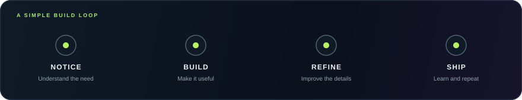
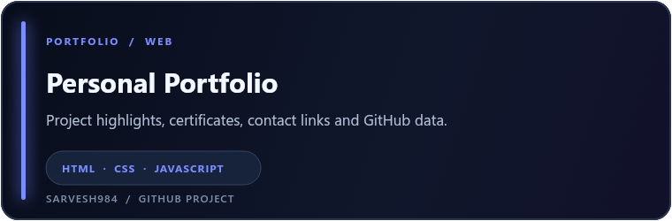

<strong>SOFTWARE ENGINEERING · WEB DEVELOPMENT · LEARNING BY BUILDING</strong> B.Tech in Information Technology · India

<a href="https://sarvesh-dev-18.netlify.app/">PORTFOLIO</a> ·
<a href="https://github.com/Sarvesh984">GITHUB</a> ·
<a href="https://www.linkedin.com/in/sarvesh-chakravarthy-3874a1424">LINKEDIN</a> ·
<a href="mailto:sarveshchakravarthy00@gmail.com">EMAIL</a>

---

## About

I’m Sarvesh, an aspiring software engineer and web developer with a B.Tech in Information Technology. I learn by building practical projects and improving the details that make software useful and clear. My work includes a React and TypeScript event website, an interactive portfolio, a Python and Tkinter quiz app, and a Java booking app.

**Focus:** Software and web development · **Based in:** India · **Open to:** Opportunities

## Skills

[Explore the interactive skills-to-project map](https://sarvesh-dev-18.netlify.app/#skills)

## Featured projects

Four projects, each linked to its source and shown with a locally stored preview.

<table>
<tr>
<td width="50%" align="center" valign="middle">

 <strong>KYN × VAMOS Website</strong> Race information, event-day experiences, and partner highlights.

</td>
<td width="50%" align="center" valign="middle">

 <strong>Personal Portfolio</strong> Interactive skills, selected work, certificates, and live GitHub data. <a href="https://sarvesh-dev-18.netlify.app/">Open the live site ↗</a>

</td>
</tr>
<tr>
<td width="50%" align="center" valign="middle">

 <strong>Python Quiz App</strong> Tkinter quizzes with randomized questions and score summaries.

</td>
<td width="50%" align="center" valign="middle">

 <strong>Turf Slot Booking System</strong> Java console booking flow with availability and receipts.

</td>
</tr>
</table>

## GitHub activity

 

 

---

<em>Notice a need. Build a useful solution. Keep improving.</em>

