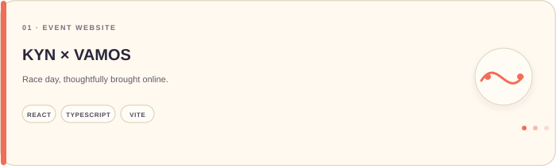
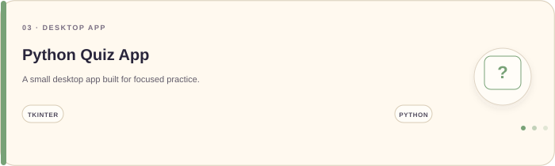
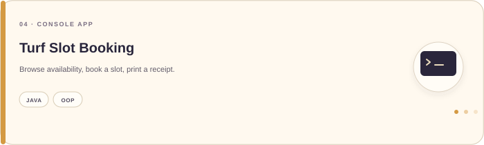

## About me

<h2 align="center">Sarvesh Chakravarthy</h2>

I’m an aspiring software engineer and web developer with a B.Tech in Information Technology. I learn by building practical projects and improving them through feedback. I’m interested in web development, Python, Java, and Flutter.

  

---
## Skills in context

[Explore the interactive skills-to-project map](https://sarvesh-dev-18.netlify.app/#skills)

## Featured projects

Four projects, each linked to its source and represented with a custom vector preview.

<a href="https://sarvesh-dev-18.netlify.app/">Open the live portfolio ↗</a>

## GitHub activity

 

 

---

<em>Notice a need. Build a useful solution. Keep improving.</em>

