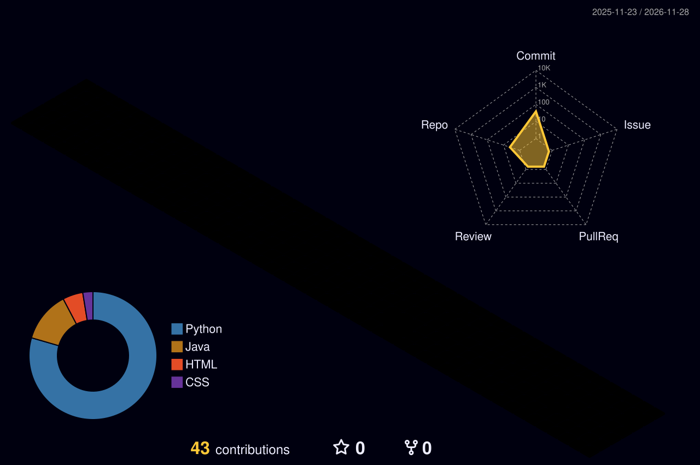

<div align="center">


<a href="https://readme-typing-svg.demolab.com"></a>


[](https://www.linkedin.com/in/sarvesh-chakravarthy-3874a1424)
[](mailto:sarveshchakravarthy00@gmail.com)

</div>


## `whoami` — About me

I’m an aspiring software engineer and web developer who learns by building practical projects. I’m interested in Python, Java, JavaScript, and Flutter, and I enjoy making software easier to use and understand.

```js
const sarvesh = {
  focus: "Web development",
  learningByBuilding: true,
  featuredProject: "KYN × VAMOS Website",
  technologies: ["React", "TypeScript", "JavaScript", "HTML", "CSS", "Python", "Java", "Flutter"]
};
```

## ✦ Featured project

<div align="center">

<a href="https://github.com/Sarvesh984/kynxvamous-website"></a>

[**↗ Explore the complete KYN × VAMOS website project**](https://github.com/Sarvesh984/kynxvamous-website)

</div>

## ✧ Projects in motion

<div align="center">

</div>

## ⚡ Tech I use

<div align="center">


</div>


## ⌁ GitHub analytics

<div align="center">

<a href="https://github.com/Sarvesh984"></a>
<a href="https://github.com/Sarvesh984"></a>

<br />


<br />


<br />


</div>

## ◈ Contribution animations

<div align="center">

<picture>
  <source media="(prefers-color-scheme: dark)" srcset="https://raw.githubusercontent.com/Sarvesh984/Sarvesh984/output/github-snake-dark.svg" />
  <source media="(prefers-color-scheme: light)" srcset="https://raw.githubusercontent.com/Sarvesh984/Sarvesh984/output/github-snake.svg" />
  
</picture>

<br />



</div>

---

<div align="center">

<a href="https://readme-typing-svg.demolab.com"></a>


</div>
