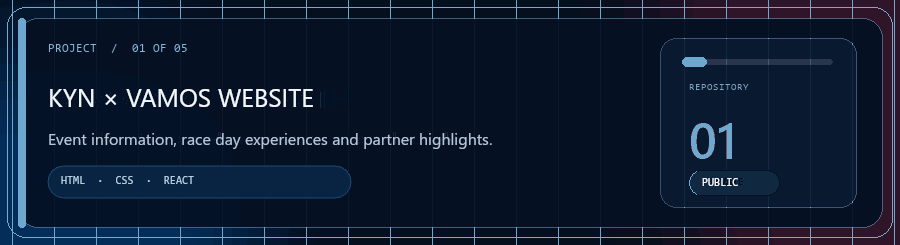

## About me

I’m an aspiring software engineer and web developer who learns by building practical projects. I’m interested in Python, Java, JavaScript, and Flutter, and I enjoy making software easier to use and understand.

## Featured project

[**KYN × VAMOS Website — view the full project**](https://github.com/Sarvesh984/kynxvamous-website)

## My repositories

 

| Repository | Overview | Stack | Access |
| --- | --- | --- | :---: |
| [KYN × VAMOS Website](https://github.com/Sarvesh984/kynxvamous-website) | Event website with race information, event day experiences, and partner highlights. | React · TypeScript · HTML · CSS | 🌐 Public |
| [Personal Portfolio](https://github.com/Sarvesh984/portfolio) | Single-page portfolio with project highlights, certificates, contact links, and live public GitHub data. | HTML · CSS · JavaScript | 🔒 Private |
| [Python Quiz App](https://github.com/Sarvesh984/python-quiz-app) | Desktop multiple-choice quiz with two built-in quizzes, random selection, and a score summary. | Python · Tkinter | 🌐 Public |
| [Turf Slot Booking System](https://github.com/Sarvesh984/turf-booking-java) | Java console app for viewing sample turf slots, making bookings, and printing an in-memory receipt. | Java · OOP | 🌐 Public |
| [GitHub Profile README](https://github.com/Sarvesh984/Sarvesh984) | The source for this animated profile page. | Markdown · GitHub | 🌐 Public |

## Technologies

## GitHub activity

 

---

*Thanks for stopping by — I’m learning, building, and improving one project at a time.*

