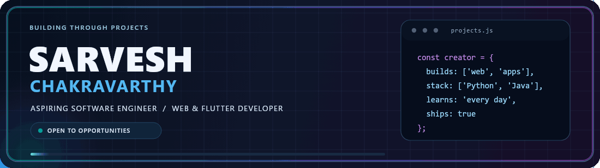
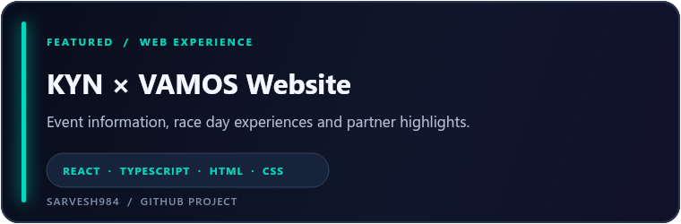
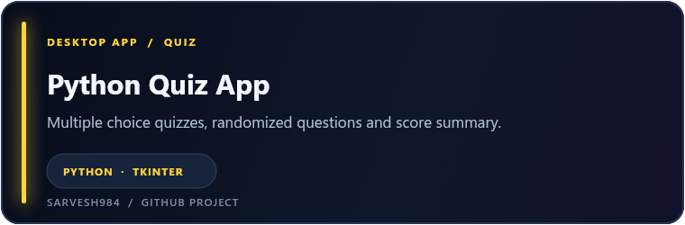
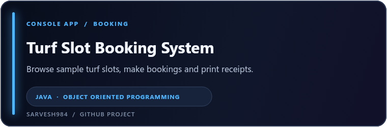
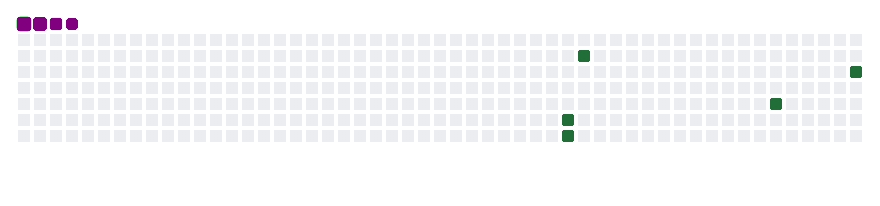

<strong>SOFTWARE ENGINEER · WEB DEVELOPER · FLUTTER DEVELOPER</strong> Building practical projects and learning by shipping.

## About

<table>
<tr>
<td width="62%" valign="middle">

I’m an aspiring software engineer and web developer with a B.Tech in Information Technology. I enjoy building useful, user-friendly applications, learning through projects, and improving my work through feedback.

**Focus:** Software and web development 
**Based in:** India 
**Open to:** Opportunities

[Portfolio website](https://sarvesh-dev-18.netlify.app/) · [GitHub profile](https://github.com/Sarvesh984)

</td>
<td width="38%" align="center" valign="middle">

<strong>B.Tech · Information Technology</strong> India  <strong>Open to opportunities</strong>

</td>
</tr>
</table>

## Skills

<strong>Technologies connected to my portfolio work</strong>

[Explore the interactive skills-to-project map](https://sarvesh-dev-18.netlify.app/#skills)

## Featured projects

All four projects are featured below. Each card is stored in this repository, so the project visuals do not depend on a third-party card service.

<table>
<tr>
<td width="50%" align="center" valign="middle">

 <b>KYN × VAMOS Website</b> Event information, race-day experiences and partner highlights.
</td>
<td width="50%" align="center" valign="middle">

 <b>Personal Portfolio</b> Projects, certificates, contact details and live GitHub data.
 <a href="https://sarvesh-dev-18.netlify.app/">Visit live portfolio</a>
</td>
</tr>
<tr>
<td width="50%" align="center" valign="middle">

 <b>Python Quiz App</b> Tkinter quiz with randomized questions and score summary.
</td>
<td width="50%" align="center" valign="middle">

 <b>Turf Slot Booking System</b> Java console app for browsing slots, making bookings and printing receipts.
</td>
</tr>
</table>

## GitHub activity

 

 

 

## Contribution animations

<picture>
  <source media="(prefers-color-scheme: dark)" srcset="https://raw.githubusercontent.com/Sarvesh984/Sarvesh984/output/github-snake-dark.gif" />
  <source media="(prefers-color-scheme: light)" srcset="https://raw.githubusercontent.com/Sarvesh984/Sarvesh984/output/github-snake.gif" />
  
</picture>

 

---

<em>Thanks for visiting — keep building useful things.</em>

